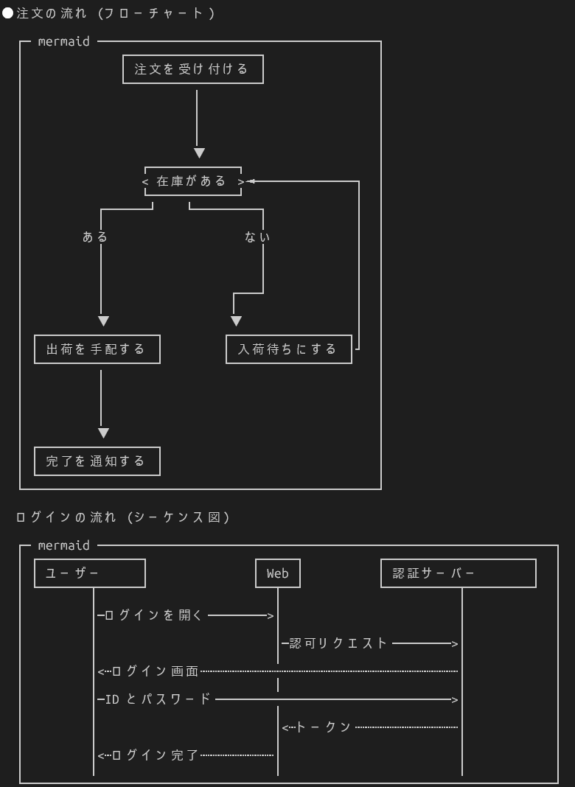

# md-view

Claude Code の端末で、返答に含まれる ```` ```mermaid ```` ブロックを [leaf](https://github.com/RivoLink/leaf) の ASCII 図で表示する mod。`/md` で Markdown ファイルを pane に表示する機能もある。



Desktop の Claude Code タブは mermaid を自前で図にするため、md-view は端末だけを担当する。

## 機能

| 対象 | 動作 |
| --- | --- |
| 端末の返答中の mermaid | `leaf --inline plain:<幅>` の ASCII 図を ```` ```text ```` フェンスに差し替えて表示する。保存される本文は元のまま (ctrl+o で原文)。```` ````markdown ```` など他のコードフェンスの中に書かれた mermaid は図にしない |
| `/md [path]` | Markdown ファイルを pane に表示する。引数なしは直前に表示したファイル。本文は Claude の返答と同じ Markdown 描画で、端末では mermaid を上と同じ方法で図にする |
| pane のボタン | `l`: leaf で全文を描画する表示との切替 / `f`: Claude が Write・Edit した .md への追従の ON・OFF (pane を開いている間だけ) / `r`: 再読込 |
| ファイルの更新 | pane を開いている間、1.5 秒ごとに更新日時と pane 幅を確認し、変わっていれば描き直す |
| システムプロンプト | 図になる surface (端末 + leaf、または Desktop) があるときだけ、「説明が図で速く伝わるときは mermaid を使ってよい。短い返答や本文の繰り返しになる図は不要」という一節を足す |

leaf がなければ mermaid はソースのまま表示し、入れ方を toast で一度だけ知らせる。mod が自動で導入することはない。leaf の有無は 30 秒おきに確認し直すため、後から入れても reload は不要。システムプロンプトは会話の最初に決まるため、一節が足されるのは入れた後の新しい会話から。

[docs/demo.md](docs/demo.md) を `/md` で開くか、Claude に「demo.md の mermaid をそのまま返答に出して」と頼むと動きを確かめられる。

**Team / Enterprise の組織や管理設定のある PC ではシステムプロンプトの一節は効かない**: 組み込みの `cc-plugin-sec-default` が、ユーザーが入れたプラグインの `prompt.compose` などプロンプトを変えるイベントを飛ばすため (起動時に「md-view: its prompt.compose hook was skipped」と出る)。図の描画は動く。mermaid を使わせたい場合は CLAUDE.md に書く。

**端末以外は書き換えない**: Desktop は自前で図にする。VS Code とモバイルでの表示はそれぞれの描画に任せる (未確認)。

## 依存

[leaf](https://github.com/RivoLink/leaf) (Rust 製の単体バイナリ)。次のどれかで入れる。他の方法は [leaf の README](https://github.com/RivoLink/leaf#install)。apt にはなく、snap にあるものは作者以外の配布のため使わない。

```sh
curl -fsSL https://raw.githubusercontent.com/RivoLink/leaf/main/scripts/install.sh | sh   # 公式スクリプト (Node 不要)
brew install leaf-markdown-viewer
npm install -g @rivolink/leaf
```

## 公式の mermaid 対応との関係

- Desktop の Claude Code タブは mermaid のブロックを図として表示する (図とソースの切り替えボタン付き)
- Claude Code 本体には端末向けの組み込み mod `cc-plugin-mermaid` も同梱されている (フローチャートとシーケンス図を罫線の図にする)。ただし機能フラグ `tengu_mermaid_mod` で止められていて、2.1.322 時点ではユーザー側から有効にできない
- 有効になった場合も、ユーザーが入れたプラグインが組み込みより先に動くため、md-view が描いた図は二重に描かれない。md-view が描けなかった図だけを公式が描く

## ファイル構成

```
md-view/
├── .claude-plugin/plugin.json
├── hooks/
│   ├── hooks.json
│   ├── register.tsx        # 返答の mermaid 描画 / /md pane / システムプロンプトの一節
│   └── register.test.tsx   # claude plugin test plugins/md-view
├── types/index.d.ts        # $.state の型 (md-view.view)
├── docs/
│   ├── demo.md             # 動作確認用の図 3 つ
│   └── images/terminal.png
├── CHANGELOG.md
└── README.md
```
