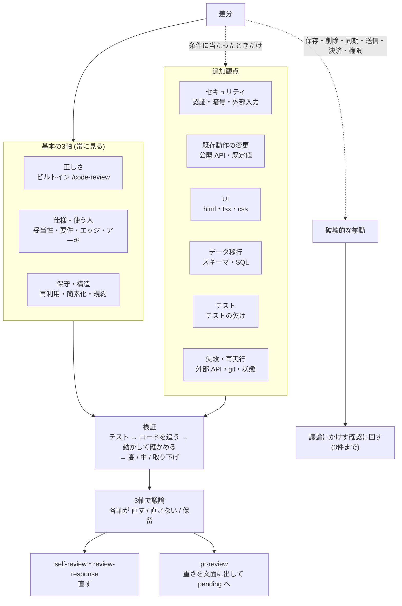

# review-kit

Claude が行うすべてのレビューで同じ原則を使うためのプラグイン。PR 番号を渡すだけで、レビュー・指摘への対応・自分の変更の見直しまでを同じ基準で回す。原則は `references/principles.md` の1か所に置き、4つのスキルがそこから読む。

## インストール

```bash
/plugin marketplace add kuu13580/dotfiles          # 初回だけ
/plugin install review-kit@kuu13580-marketplace
```

入れずに試すだけなら `claude --plugin-dir <このディレクトリ>` で起動する。

## 使い方: PR 番号を渡すだけ

| やりたいこと | コマンド | 何が起きるか |
| --- | --- | --- |
| 他人の PR をレビューする | `/pr-review 123` | 変更の解説を作り、確認が要る指摘をすべて pending に置く。GitHub で pending を読み、不要なものを消して submit するだけ |
| レビューした PR の修正を確かめる | `/pr-review 123` | 前回の指摘が直ったかを判定し、Resolve・Approve を提案する (フェーズは自動で切り替わる) |
| 自分の PR に来た指摘に対応する | `/review-response 123` | 指摘を確かめて直し、全件の返信案を出す。承認すると push・返信・再レビュー依頼まで行う |
| 自分の変更を見直す | `/self-review` | 見つけたものをその場で直す。実装の区切りでは Claude が自分で実行する |
| 自分の下書きレビューを確かめる | `/check-review-validity 123` | 下書きの各指摘を ✅ 妥当 / ✏️ 要修正 / ❌ 取り下げ推奨 / ❓ 要確認 に分ける |

- PR 番号の代わりに URL も渡せる。省略すると、カレントブランチの PR や自分宛のレビュー依頼から選ぶ
- 「PR #123 をレビューして」のような自然文でも動く
- どのスキルを呼んでも、最初にローカルと GitHub の状態を見て、別のスキルが合えば切り替えを提案する ([references/routing.md](references/routing.md))
- 深さや観点は引数で足せる: `/pr-review 123 max` (漏れ探しまで行う)、`/self-review +security` (追加観点を指定)。pr-review の引数の詳細は [skills/pr-review/SKILL.md](skills/pr-review/SKILL.md)

### GitHub への書き込み

| スキル | 書き込み |
| --- | --- |
| pr-review | pending への投稿は確認なし。Approve・返信・Resolve は承認後。submit はしない |
| review-response | 返信・再レビュー依頼は、返信案と push の承認後 |
| self-review / check-review-validity | なし |

## レビューの観点と流れ

基本の3軸は常に見て、差分の中身に応じて追加観点を足す。どの観点で見つけたものも、検証してから3軸で議論して決める。



- 追加観点は、差分のファイル種別・パス・内容が条件に当たったときだけ足す (引数 `+security` などでも足せる)。条件の全文は [references/principles.md](references/principles.md) の §1
- 正しさは、差分の大半が指示文・設定のときはビルトインの代わりにサブエージェントが見る
- 確度: 高 (テスト・コード・実際の動作で確定) / 中 (仕組みは実在するが、きっかけが不確か) / 取り下げ (否定する行を引用できたものだけ)
- 3軸の議論: 一致で決定、2対1 は多数決で少数意見を報告、割れたときやデータの破損に関わるときはユーザーに委ねる
- 規約違反は、規約の原文と違反行を引用できたら議論にかけずに直す・投稿する。lint が拾うものは指摘しない
- 詳細は [references/principles.md](references/principles.md)

## トークン量の計測

各スキルは最後の報告に、その回で使ったトークン量を1行で付け、`~/.claude/review-kit/usage.tsv` に追記する。メインとサブエージェントの分を合わせ、新規に処理した量 (入力 + キャッシュ書き込み + 出力) とキャッシュ読み込みを分けて出す。あとから見るときは次を実行する:

```bash
python3 plugins/review-kit/scripts/usage-report.py --all   # このセッションの回ごと
column -t -s $'\t' ~/.claude/review-kit/usage.tsv         # これまでの記録
```

1回の範囲は、スキルを呼んだ時点から次に review-kit のスキルを呼ぶまで。review-response の中で呼ぶ self-review は別の回として出る。

## 前提条件

- `gh` CLI がインストール済みかつ認証済み (`gh auth login`)
- `jq` / `python3` / `git` がインストール済み
- 推奨: `explain-change` (pr-review が変更の解説ページを作るのに使う)。無くても動くが、解説は 5 行の要点だけになり、報告で入れ方を案内する
- 任意: `ui-principles` (UI の追加観点で使う)、`readable-writing` (報告に使う)。無ければその部分を省いて進む

## ファイル構成

```
review-kit/
├── .claude-plugin/plugin.json
├── references/
│   ├── principles.md            # 共通の原則 (観点・洗い出し・確度・直す判断・3軸の議論)
│   └── routing.md               # 状態から合うスキルを選ぶ表
├── scripts/
│   ├── detect-state.sh          # ローカルと GitHub の状態から合うスキルを判定
│   ├── usage-report.py          # スキル実行で使ったトークン量をセッションの記録から集計
│   └── reply-thread.sh          # レビュースレッドに返信 (pr-review / review-response)
├── skills/
│   ├── self-review/SKILL.md
│   ├── review-response/
│   │   ├── SKILL.md
│   │   └── scripts/fetch-pr-feedback.sh   # 自分の PR に来た未解決の指摘とレビュアーの状態
│   ├── pr-review/               # SKILL.md / references (フェーズA・B) / scripts
│   └── check-review-validity/   # SKILL.md / scripts
├── CHANGELOG.md
└── README.md
```

## 旧プラグインからの移行

`pr-review` (v0.7.0) と `check-review-validity` (v1.0.1) はこのプラグインに移した。移した時点での変更点は [CHANGELOG.md](CHANGELOG.md)。

旧プラグインは、review-kit へ案内するだけのプラグインとして marketplace に残している。今までどおり `/pr-review` などで呼ぶと、review-kit が入っていればそちらに引き継ぎ、入っていなければ入れ方を案内する。移行は `/plugin marketplace update kuu13580-marketplace` → `/plugin install review-kit@kuu13580-marketplace` → `/review-kit:pr-review` などで動くことを確かめる → `/plugin uninstall pr-review@kuu13580-marketplace` などで旧プラグインを外す、の順に行う。
